<div align="center">


<br />
<br />

**Open-source, browser-based control panel for gaming mice.**<br />
Change DPI, polling rate and sensor settings with WebHID — no vendor bloatware, no account, no telemetry.

<br />

[](https://cafu1107.github.io/openglide/)

[](https://github.com/Cafu1107/openglide/actions/workflows/ci.yml)
[](https://github.com/Cafu1107/openglide/releases/latest)
[](LICENSE)
[](https://www.typescriptlang.org/)
[](https://react.dev/)
[](https://developer.mozilla.org/docs/Web/API/WebHID_API)
[](CONTRIBUTING.md)

[**Live demo**](https://cafu1107.github.io/openglide/) ·
[Supported devices](#-supported-devices) ·
[Add your mouse](docs/ADDING_A_DRIVER.md) ·
[Roadmap](docs/ROADMAP.md) ·
[Türkçe](README.tr.md)

</div>

<br />

<p align="center">
  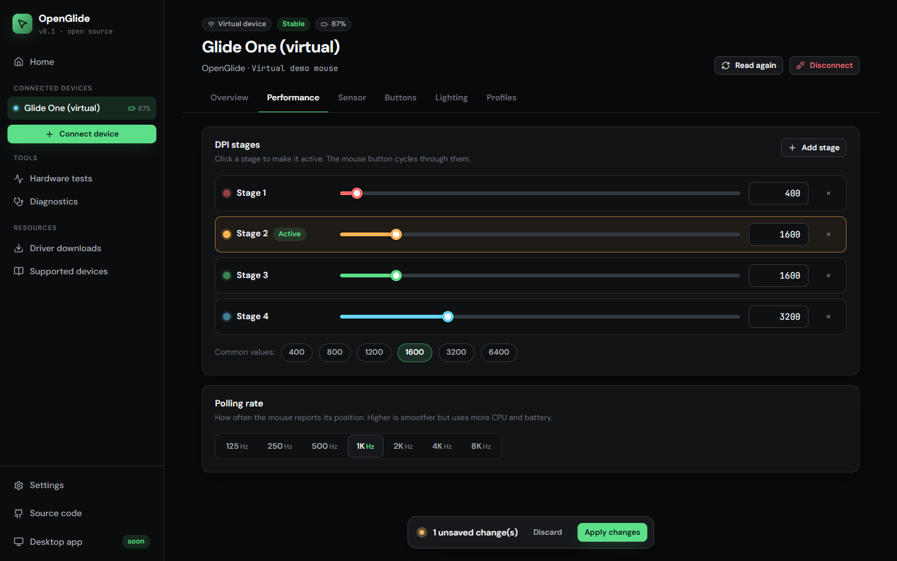
</p>

## ✨ Why OpenGlide?

Every mouse brand ships its own heavy, always-running configuration suite. OpenGlide replaces them with **one fast web page**: plug the mouse in, click *Connect*, change what you need, close the tab. Settings are written straight to the mouse over [WebHID](https://developer.mozilla.org/docs/Web/API/WebHID_API) — nothing to install, nothing running in the background.

<table>
  <tr>
    <td width="33%" valign="top">
      <h3>🎯 Performance</h3>
      Up to 5 colour-coded DPI stages, polling rate up to 8&nbsp;kHz, instant preview and a single <b>Apply</b> — or auto-apply.
    </td>
    <td width="33%" valign="top">
      <h3>🔬 Sensor tuning</h3>
      Lift-off distance, angle snapping, ripple control, motion sync, click debounce and sleep timers.
    </td>
    <td width="33%" valign="top">
      <h3>🖱️ Buttons & RGB</h3>
      Click a button on the interactive mouse to remap it. Live lighting preview with static, breathing, spectrum and wave effects.
    </td>
  </tr>
  <tr>
    <td valign="top">
      <h3>🧪 Hardware tests</h3>
      Real polling-rate graph, double-click chatter detector, scroll test and a raw-input DPI analyzer. Works with <i>any</i> mouse.
    </td>
    <td valign="top">
      <h3>⬇️ Driver hub</h3>
      27 official driver / software links (Logitech, Razer, SteelSeries, Corsair, ASUS, Pulsar, Lamzu, ATK…) — verified, searchable, never re-hosted.
    </td>
    <td valign="top">
      <h3>🔒 Private & portable</h3>
      Runs 100% locally. Export / import settings as JSON, dark & light themes, 5 accents, English & Türkçe.
    </td>
  </tr>
</table>

## 📸 Screenshots

| Home | Button mapping |
| :---: | :---: |
| 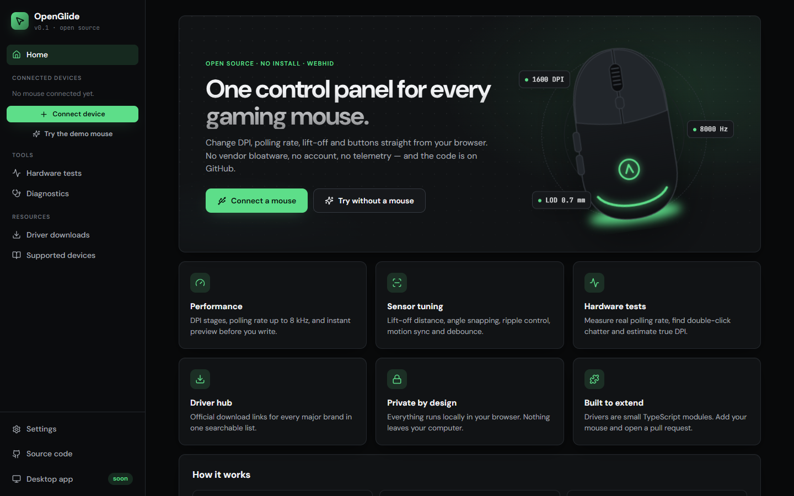 | 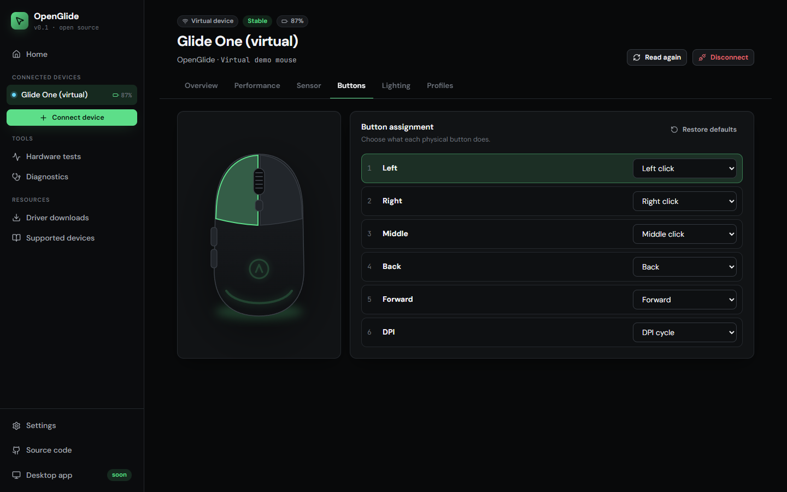 |
| **Lighting** | **Hardware tests** |
| 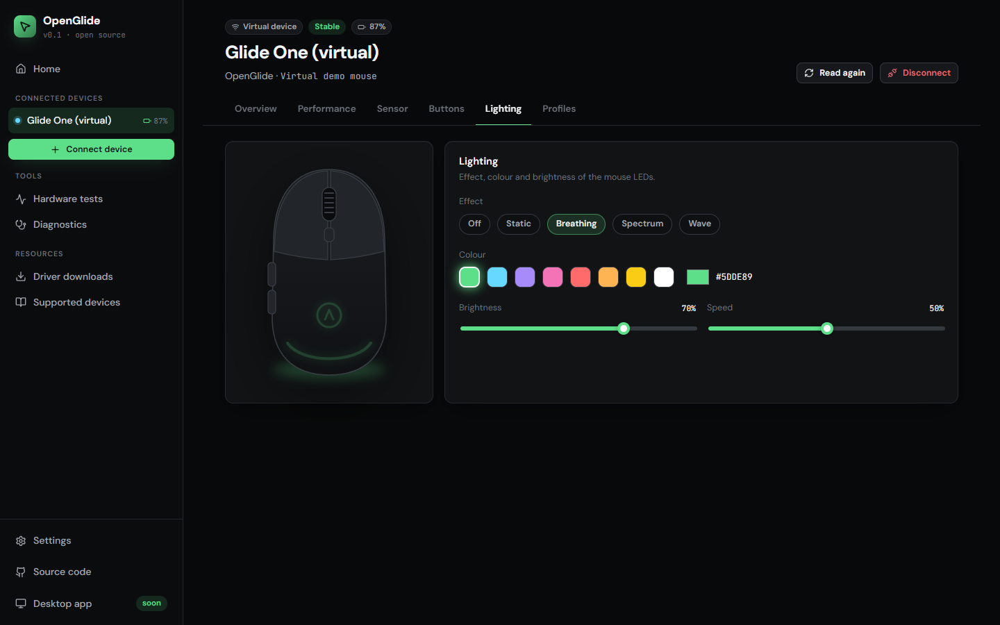 | 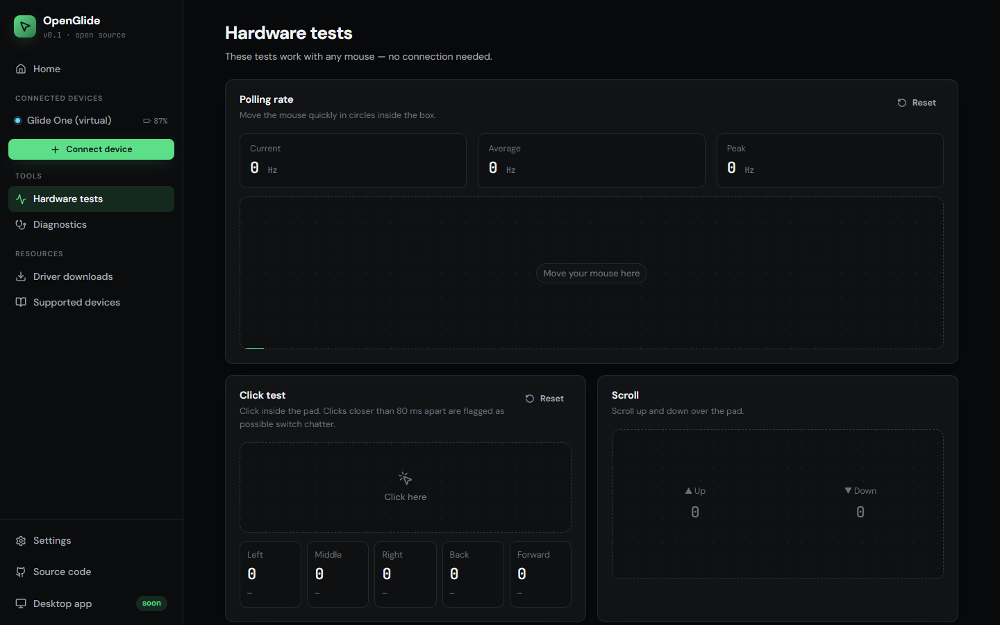 |
| **Driver downloads** | **Light theme** |
| 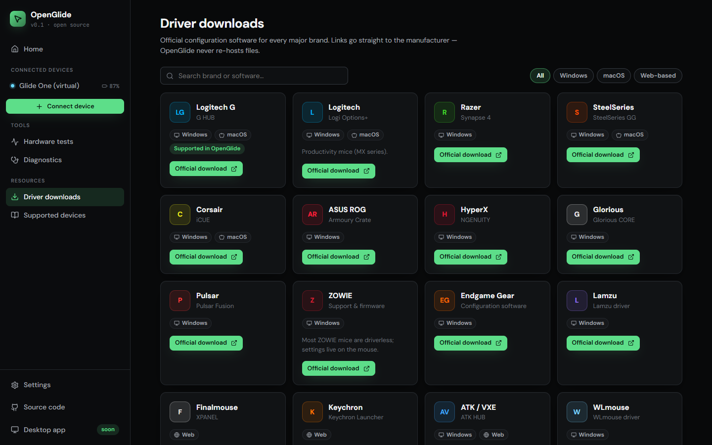 | 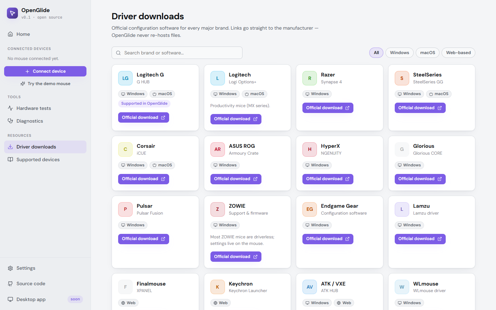 |

<details>
<summary><b>More: overview, supported devices, Turkish UI, mobile</b></summary>
<br />

| Overview | Supported devices |
| :---: | :---: |
| 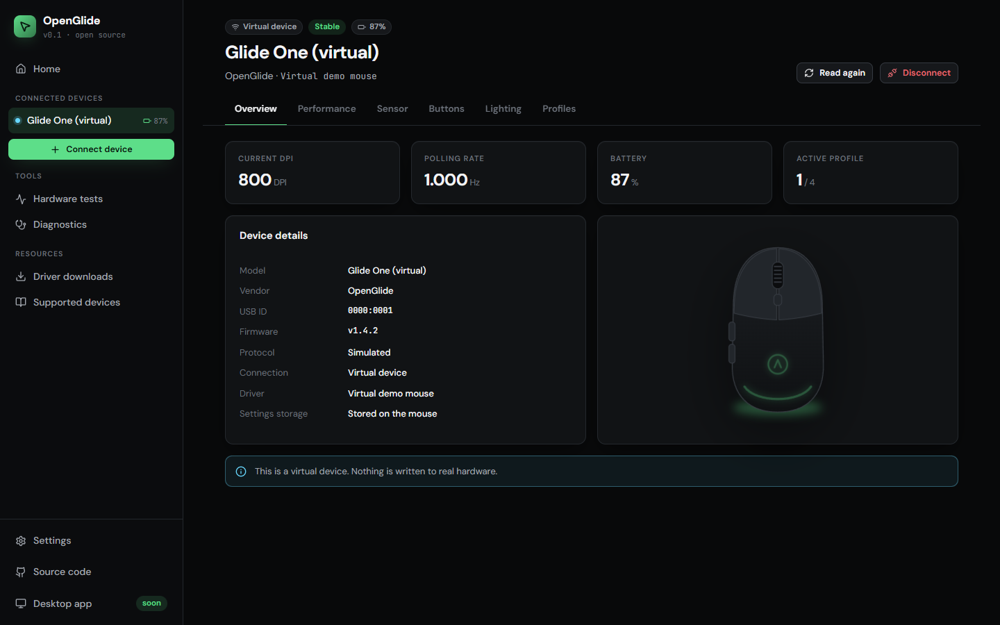 | 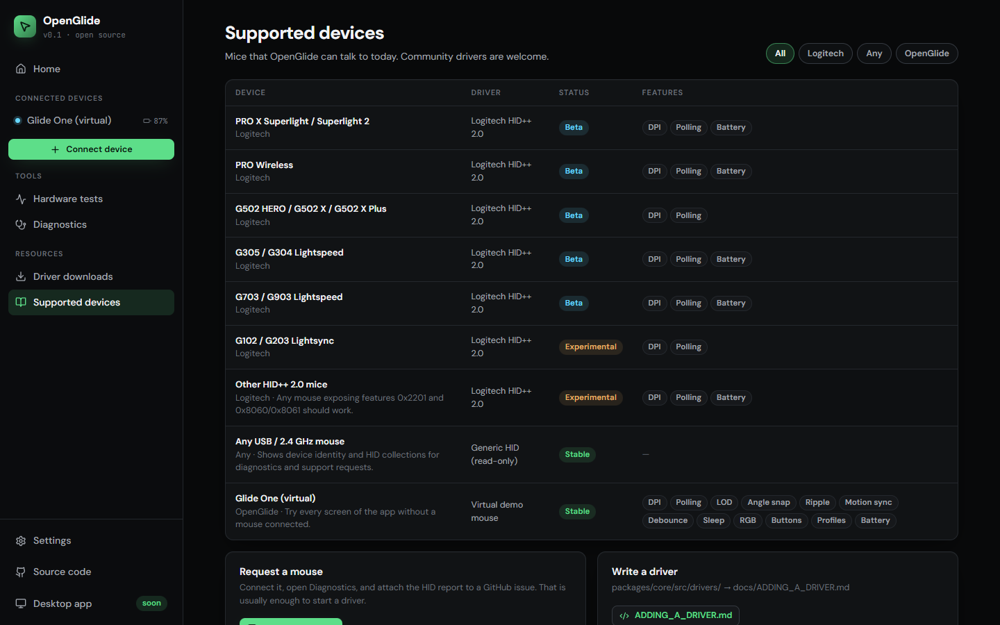 |
| **Türkçe arayüz** | **Mobile** |
| 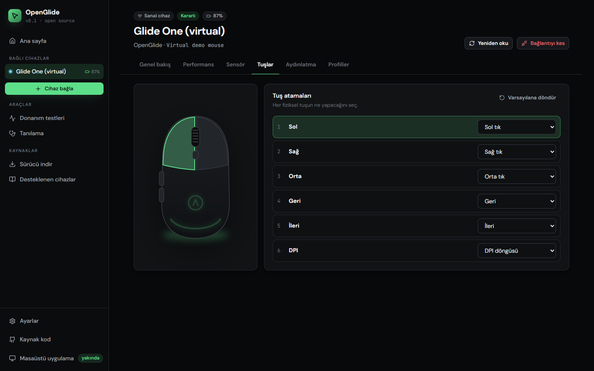 | 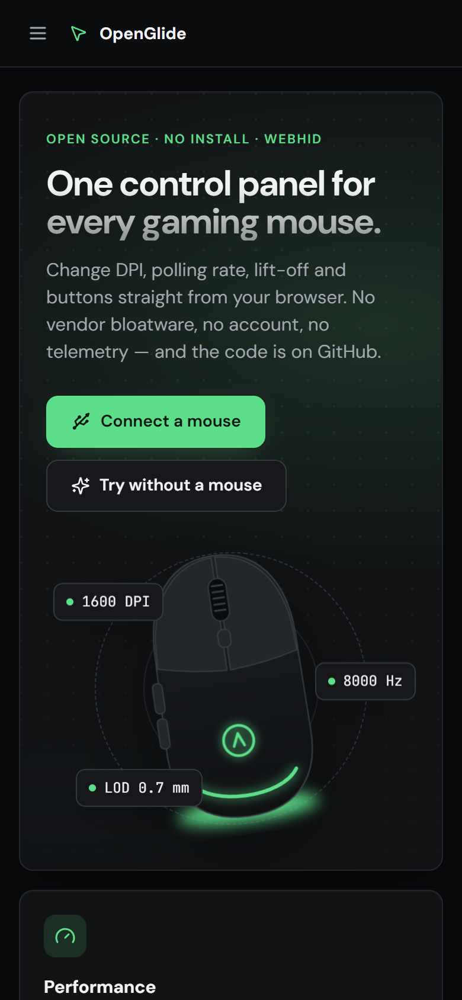 |

</details>

## 🚀 Quick start

### Use it online

1. Open **[cafu1107.github.io/openglide](https://cafu1107.github.io/openglide/)** in Chrome, Edge, Opera or another Chromium desktop browser.
2. Plug in your mouse (or its wireless receiver) and click **Connect a mouse**.
3. Change settings, then **Apply changes**.

No mouse at hand? Click **Try without a mouse** — a fully featured virtual mouse lets you explore every screen.

### Run it locally

```bash
git clone https://github.com/Cafu1107/openglide.git
cd openglide
npm install
npm run dev        # http://localhost:5173
```

| Command | What it does |
| --- | --- |
| `npm run dev` | Start the web app with hot reload |
| `npm run build` | Type-check and build to `apps/web/dist` |
| `npm test` | Run protocol unit tests (Vitest) |
| `npm run typecheck` | Strict type-check of every package |

## 🖱️ Supported devices

**40+ brands** through the [OpenMouse](https://github.com/OpenMouse-Project/mouse-protocol) protocol drivers, plus OpenGlide's own drivers:

| Brands | Settings | Button remapping |
| --- | --- | :---: |
| Razer · Pulsar · Lamzu · VGN · G-Wolves · Attack Shark / Lingbao · MCHOSE · Incott · Dareu · K-snake · Teevolution | DPI / stages · polling · lift-off · sensor options | ✅ |
| ATK (A9 / A9 Plus, X1, F1, R1) · Endgame Gear | DPI stages · polling up to 8 kHz · lift-off · motion sync · ripple · angle snapping · debounce · sleep | 👁 read-only |
| Logitech · SteelSeries · Corsair · HyperX · Glorious · ASUS ROG · Keychron · Finalmouse · WLMouse · VXE · CRDRAKO · Ninjutso · VAXEE · Redragon · Fantech · Motospeed · Microsoft · Orbital · RAWM · Zaunkoenig · moddoMOUSE · WALLHACK · Delux · Ryunix · GravaStar | DPI · polling · lift-off, and more per model (lighting on Razer / SteelSeries / Glorious) | — |
| **Any other mouse** | Identity & HID layout for diagnostics, all hardware tests | — |
| **Virtual** Glide One demo | Everything — try the full UI without hardware | ✅ |

The exact controls shown for a mouse come from its driver at connect time — OpenGlide never shows a setting the driver cannot write. The full, searchable list is on the in-app **Supported devices** page.

> **Your mouse missing?** Connect it, open **Diagnostics → Copy report** and [open a device request](https://github.com/Cafu1107/openglide/issues/new?template=device_request.yml). Protocol captures from the vendor software make it even faster. Or [write the driver yourself](docs/ADDING_A_DRIVER.md) — most are under 200 lines.

### Browser support

| Chrome / Edge / Opera / Brave (desktop) | Firefox | Safari | Mobile browsers |
| :---: | :---: | :---: | :---: |
| ✅ Full | ⚠️ Tests & drivers only | ⚠️ Tests & drivers only | ⚠️ Tests & drivers only |

WebHID is a Chromium desktop API. Other browsers can still use the demo, hardware tests and driver downloads.

## 🏗️ Architecture

OpenGlide is a small monorepo. **Protocol code never touches the UI**, so the same drivers can power a desktop app later.

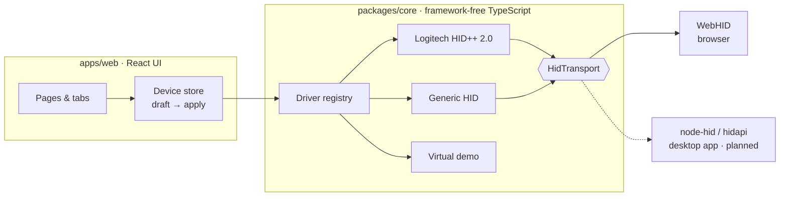

```
openglide/
├─ packages/core/            # @openglide/core — drivers, no UI, no DOM beyond WebHID
│  └─ src/
│     ├─ transport/          # HidTransport interface + WebHID implementation
│     ├─ drivers/logitech/   # HID++ 2.0: channel, feature parsers (+ unit tests)
│     ├─ drivers/generic/    # fallback for unknown mice
│     ├─ drivers/demo/       # full-featured virtual mouse
│     └─ types.ts            # MouseDevice, Capabilities, MouseState
├─ apps/web/                 # @openglide/web — Vite + React UI
│  └─ src/
│     ├─ pages/              # home, device tabs, tests, drivers, support…
│     ├─ lib/                # stores, router, settings, i18n hook
│     ├─ data/drivers.ts     # official driver download catalogue
│     └─ i18n/               # en.ts, tr.ts
└─ docs/                     # guides, roadmap, screenshots
```

**Key ideas**

- **Capabilities drive the UI.** A driver declares what the mouse supports (`dpi`, `pollingRates`, `liftOff`, `lighting`…); tabs and controls appear only when they apply.
- **Draft → apply.** Edits are kept as a local draft, shown as “N unsaved changes”, written in one batch and then read back from the mouse to confirm.
- **Pluggable transport.** Drivers only see `HidTransport` (`sendReport`, `onInputReport`, feature reports). WebHID today, `node-hid` in the desktop app tomorrow.

## 🗺️ Roadmap

- [x] WebHID core, driver registry, virtual demo mouse
- [x] Logitech HID++ 2.0 — DPI, polling rate (8060/8061), battery, firmware
- [x] Hardware tests, driver hub, diagnostics, EN/TR, themes
- [ ] Logitech onboard-profile editing (0x8100) and DPI stages
- [x] 40+ brands via OpenMouse protocol drivers, button remapping on 11 brand families
- [ ] Button remapping for ATK, Endgame Gear, SteelSeries and Logitech
- [ ] **Desktop app** (Tauri) with tray icon, per-game profiles and auto-start
- [ ] Firmware update flow for supported brands

See **[docs/ROADMAP.md](docs/ROADMAP.md)** for the desktop-app plan.

## 🤝 Contributing

Contributions of every size are welcome — a new driver, a translation, a fixed driver link or a bug report. Start with **[CONTRIBUTING.md](CONTRIBUTING.md)** and **[docs/ADDING_A_DRIVER.md](docs/ADDING_A_DRIVER.md)**.

## 🔐 Privacy & safety

- Everything runs in your browser; there is no backend and no analytics.
- The browser only exposes devices **you pick** in its permission prompt.
- Writes use the same documented commands as the vendor software. When in doubt, the vendor app can always restore defaults.

## ⚖️ Disclaimer

OpenGlide is an independent community project and is not affiliated with or endorsed by any mouse manufacturer. All product names and trademarks belong to their owners. Inspired by [OpenMouse](https://openmouse.app/). HID++ knowledge thanks to the excellent [Solaar](https://github.com/pwr-Solaar/Solaar) project.

Most vendor protocols come from the OpenMouse project's [`@openmouse/protocol`](https://github.com/OpenMouse-Project/mouse-protocol) package, used unmodified as an npm dependency. See [THIRD_PARTY_NOTICES.md](THIRD_PARTY_NOTICES.md).

## 📄 License

[MIT](LICENSE) © 2026 Cafu1107 and OpenGlide contributors

<div align="center">
<br />
<sub>If OpenGlide saved you from installing one more driver, consider leaving a ⭐</sub>
</div>
