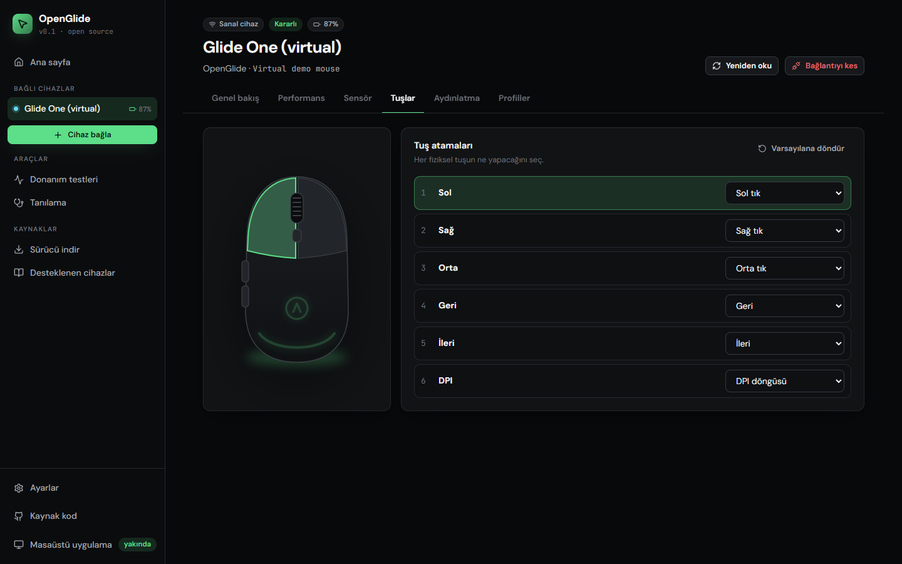

<div align="center">



<br />
<br />

**Oyuncu mouse'ları için açık kaynaklı, tarayıcı tabanlı kontrol paneli.**<br />
DPI, polling rate ve sensör ayarlarını WebHID ile değiştir — şişkin üretici yazılımı yok, hesap yok, telemetri yok.

<br />

[](https://cafu1107.github.io/openglide/)

[](LICENSE)
[](https://www.typescriptlang.org/)
[](https://developer.mozilla.org/docs/Web/API/WebHID_API)

[English](README.md) · [**Canlı demo**](https://cafu1107.github.io/openglide/) · [Mouse'unu ekle](docs/ADDING_A_DRIVER.md) · [Yol haritası](docs/ROADMAP.md)

</div>

<br />

<p align="center">
  
</p>

## ✨ Neler yapabilir?

| | |
| --- | --- |
| 🎯 **Performans** | 5 renkli DPI kademesi, 8 kHz'e kadar polling rate, önizleme ve tek tıkla uygula (veya otomatik uygula). |
| 🔬 **Sensör** | Lift-off mesafesi, açı düzeltme, ripple control, motion sync, debounce, uyku süresi. |
| 🖱️ **Tuşlar ve RGB** | Etkileşimli mouse çiziminde tuşa tıkla, yeniden ata. Canlı aydınlatma önizlemesi. |
| 🧪 **Donanım testleri** | Gerçek polling rate grafiği, çift tıklama arıza testi, tekerlek testi, ham girdi ile DPI ölçer. Her mouse ile çalışır. |
| ⬇️ **Sürücü merkezi** | 27 markanın doğrulanmış resmi sürücü bağlantıları (Logitech, Razer, SteelSeries, Rampage, Everest…). |
| 🔒 **Gizlilik** | Her şey tarayıcında çalışır. Ayarları JSON olarak dışa/içe aktar. Koyu/açık tema, Türkçe/İngilizce. |

## 🚀 Başlarken

**Online:** [cafu1107.github.io/openglide](https://cafu1107.github.io/openglide/) adresini Chrome, Edge veya Opera ile aç → mouse'u tak → **Mouse bağla**.
Mouse'un yanında değil mi? **Mouse olmadan dene** ile sanal mouse'la tüm ekranları gez.

**Kendi bilgisayarında:**

```bash
git clone https://github.com/Cafu1107/openglide.git
cd openglide
npm install
npm run dev        # http://localhost:5173
```

## 🖱️ Desteklenen cihazlar

| Marka | Cihazlar | Durum |
| --- | --- | :---: |
| **Logitech** | PRO X Superlight 1/2, PRO Wireless, G502, G305, G703, G903 ve diğer HID++ 2.0 mouse'lar | Beta |
| **Her mouse** | Tanılama bilgisi + tüm donanım testleri | Kararlı |
| **Sanal** | Glide One demo mouse — tüm özellikler | Kararlı |

Mouse'un listede yok mu? Bağla, **Tanılama → Raporu kopyala** de ve [cihaz isteği aç](https://github.com/Cafu1107/openglide/issues/new?template=device_request.yml).

## 🖥️ Masaüstü uygulaması

Protokol kodu (`packages/core`) arayüzden tamamen ayrı yazıldı; aynı sürücüler ileride **Tauri** tabanlı bir masaüstü uygulamasında (sistem tepsisi, oyuna göre profil, otomatik başlatma) kullanılacak. Plan için: [docs/ROADMAP.md](docs/ROADMAP.md).

## 📄 Lisans

[MIT](LICENSE) © 2026 Cafu1107 ve OpenGlide katkıcıları. Hiçbir mouse üreticisiyle bağlantılı değildir.
